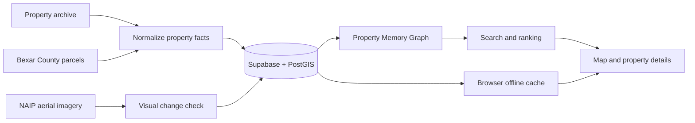

# SiteLedger CRE

SiteLedger CRE is a prototype for finding and tracking commercial real-estate opportunities in San Antonio.

> **Project notice:** Built by **Shruthi Senthilarasu** as a contracted software engineer for **Tanner of Octave Commercial Real Estate Partners**. Shruthi Senthilarasu does not own this project. This is prototype software, not a production system.

## What it does

- Shows commercial properties on a satellite map.
- Adds parcel, zoning, traffic, site-plan, and marketing information.
- Compares historical aerial images to flag possible physical changes.
- Searches property memory with plain-English questions.
- Explains why each property matched a search.
- Caches property data so the prototype can continue working offline.

Example search:

> Find C-3 development sites larger than 5 acres.

## Data flow



In simple terms:

1. Collect property documents and public data.
2. Convert them into consistent property facts and dated events.
3. Store the facts, locations, sources, and imagery history in Supabase.
4. Search across location, zoning, physical form, traffic, and property history.
5. Show each result with its supporting evidence and confidence.

## Current data

The prototype currently includes eight properties from the supplied San Antonio archive. It also connects to:

- [Bexar County GIS](https://maps.bexar.org/arcgis/rest/services/Parcels/MapServer) for parcel context.
- [Esri World Imagery](https://services.arcgisonline.com/ArcGIS/rest/services/World_Imagery/MapServer) for the satellite basemap.
- [Microsoft Planetary Computer](https://planetarycomputer.microsoft.com/docs/) for historical USDA NAIP imagery.
- Supabase for the hosted spatial database and search API.

## How it can expand

### 1. Add more real-estate data

- Official zoning districts and overlays
- Building permits and certificates of occupancy
- Floodplains, utilities, easements, and environmental constraints
- Traffic, mobility, demographics, and nearby development
- Sale, lease, tax, deed, and ownership history

### 2. Add continuous monitoring

- Check new imagery on a schedule.
- Detect clearing, grading, construction, vacancy, and demolition.
- Watch selected properties and saved searches.
- Send alerts when a meaningful change is found.

### 3. Add stronger AI

- Detect buildings, parking, drive-through lanes, signs, and impervious cover.
- Create embeddings for semantic and visual similarity.
- Match parcels to development requirements.
- Produce explainable opportunity scores instead of unsupported AI answers.

### 4. Prepare for production

- Add user accounts, organizations, and review permissions.
- Require human approval for AI-generated change events.
- Add ingestion workers, monitoring, backups, and audit logs.
- Add exports, reports, field notes, and CRM integrations.

## Technology

- Vite and JavaScript
- MapLibre GL JS
- Supabase and PostgreSQL
- PostGIS for maps and spatial searches
- pgvector for future AI similarity search
- Vitest, ESLint, and Prettier
- GitHub Pages for the static frontend

## Run locally

Requires Node.js 22 or later.

```bash
npm install
npm run dev
```

Without Supabase settings, the app uses its bundled offline demo data.

To use Supabase, copy `.env.example` to `.env.local` and add the project URL and publishable key. Never put a Supabase secret key in the browser or repository.

## Database deployment

```bash
npx supabase login
npx supabase link YOUR_PROJECT_REF
npx supabase db push --remote --include-seed
```

Database migrations and demo seed data are in `supabase/`.

## Quality check

```bash
npm run check
```

This checks formatting, runs the tests, and builds the GitHub Pages version into `docs/`.

## Important limitations

- Archive facts may come from marketing or site-plan documents.
- Parcel and imagery sources have different update dates.
- Image-change scores can be affected by seasons, shadows, and source alignment.
- All zoning, legal, financial, engineering, and development conclusions require professional verification.
